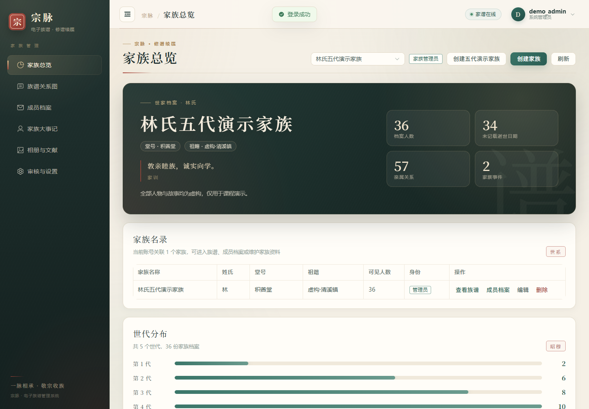
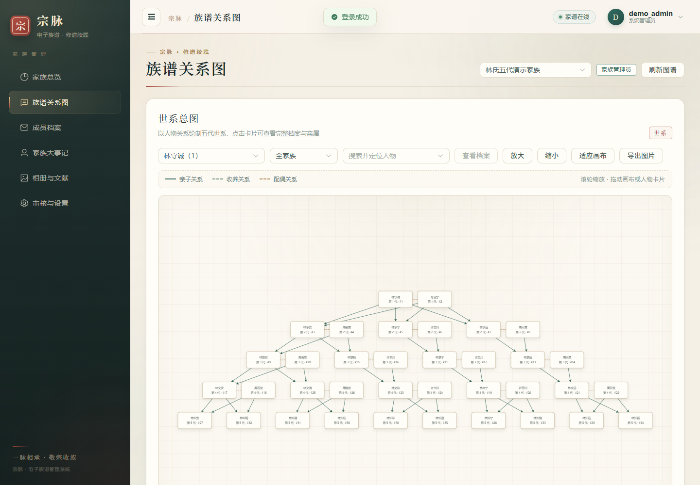

# 宗脉电子族谱管理系统

系统使用 Vue 3、JavaScript、Element Plus、G6 5.1.1、Spring Boot 3.3.5、Java 17、JdbcTemplate 和 MySQL 8。登录采用 Session 与 CSRF 校验。附带独立 H2 演示环境，可以直接查看36位虚构人物组成的五代世系。界面以宣纸、墨玉和朱砂印章为主视觉，侧栏、家族总览、世系图、成员档案、大事记、相册、审核设置与登录页采用统一设计。

## 界面预览





## 启动独立演示

首次使用先安装和打包。在项目根目录执行以下命令。

```powershell
cd frontend
npm ci
npm run build
cd ../backend
mvn package
cd ..
.\tools\Start-Demo.ps1
```

访问 `http://127.0.0.1:5175/auth/login`。后端使用9080端口，演示数据保存在 `backend/data/demo.mv.db`。

`Start-Demo.ps1` 默认用 `vite preview` 托管已构建的 `frontend/dist`，也就是21项浏览器验收使用的生产预览。需要开发热更新时，先关闭已有前端进程，再运行 `\tools\Start-Demo.ps1 -Development`。

| 演示账号 | 初始密码 | 身份 |
| --- | --- | --- |
| demo_admin | Demo123! | 家族管理员与演示系统管理员 |
| demo_member | Demo123! | 普通成员，可提交审核申请 |
| demo_outsider | Demo123! | 无关联家族的账号 |

演示密码可在首次初始化前用 `DEMO_PASSWORD` 环境变量设置。已有账号保留其原密码。演示环境默认在本机使用，正式 MySQL 环境按部署说明创建账号和设置密码。

## 已接入的功能

- 注册、登录、退出、会话校验、家族数据隔离、管理员和普通成员权限。
- 多家族管理、家族简介和家训维护、始祖设置、账号关联、角色变更与最后管理员保护。
- 人物资料增删改查、姓名与世代及出生年份筛选、后端分页、头像与可见范围。
- 亲子、配偶、收养关系维护，重复、自关联、跨家族和亲子环路检查。
- 五代图谱、关系连线、缩放拖动、人物定位、资料侧栏、祖先后代范围、后代折叠、PNG导出。
- 大事记、照片及PDF文献上传、人物和事件关联、管理员私密档案。
- 普通成员修改申请、管理员审核、过期申请冲突检查、操作日志、统计、CSV与JSON导出。
- 管理员授权公开家族简介，游客通过 `/public` 查看。
- 系统管理员查看和启停账号，停用状态会阻止已有会话访问受保护数据。

## 使用现有 MySQL

执行 `backend/src/main/resources/db/schema.sql` 和 `extensions.sql` 完成建表。为 `family_app` 配置 `family_tree` 数据库权限后，在项目根目录执行以下脚本并交互输入数据库密码。

```powershell
.\tools\Start-MySQL.ps1
```

另开终端进入 `frontend` 执行 `npm run dev`。默认代理到8080端口。系统启动时为旧表补充缺失的新增字段，因此第一次升级需要 `CREATE` 与 `ALTER` 权限。

## 测试与交付资料

```powershell
node --test tools/tree-layout.test.mjs
python tools/verify_api.py --report test-results/api.json
python tools/verify_mysql.py
python tools/verify_delivery.py
```

`verify_delivery.py` 逐项核对交付压缩包的清单、SHA-256、必需文件、禁用内容和三份验收记录。`verify_mysql.py` 每次重新创建一次性 MySQL 实例，结束后删除临时数据目录。

接口脚本创建独立的虚构测试账号和家族。MySQL测试脚本在13306端口创建临时实例，完成后关闭测试进程。脚本中的 MySQL 安装目录可用 `--mysql-bin` 参数调整。

浏览器测试使用项目锁定的 `@playwright/test` 与本机 Chrome，运行 `node tools/verify_browser.mjs` 即可。测试支持 `TEST_BASE_URL` 和 `TEST_BROWSER_CHANNEL` 环境变量，也可以安装 Playwright Chromium 后将 `TEST_BROWSER_CHANNEL` 设置为 `chromium`。

- `项目文档/交付资料/部署与使用说明.md`
- `项目文档/交付资料/需求数据库与接口说明.md`
- `项目文档/交付资料/测试报告.md`
- `项目文档/交付资料/课程报告.md`
- `项目文档/交付资料/演示脚本.md`
- `backend/src/main/resources/db/demo-data.sql`

图谱通过现有真实关系计算布局。`generation` 只用于展示与筛选。普通配偶在同层排列，跨代配偶等复杂结构会采用独立人物层级。JSON导出保存档案二进制内容，完整数据库恢复使用 MySQL 备份。

