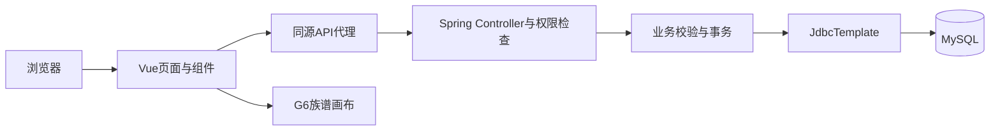

# 宗脉电子族谱管理系统设计与实现

## 摘要

电子族谱管理系统将家族人物资料、亲属关系、家族事件与文化档案统一保存，并通过可交互的世系图呈现家族传承。本项目使用Spring Boot、Vue 3、MySQL和G6，完成人物与关系管理、家族权限控制、祖先后代追溯及图谱交互。系统采用人物表与关系表分别建模，允许双亲、配偶、收养和缺失资料共存，并以家族事务锁处理并发关系写入的一致性。课程演示提供36位虚构人物组成的五代世系，配有管理员、普通成员和无关联账号。验收覆盖接口权限、关系规则、审核冲突、文化档案与页面交互。

关键词包括电子族谱、关系建模、Spring Boot、Vue、数据可视化。

## 研究背景与建设目标

纸质族谱在持续修订、跨地域协作和资料检索方面存在成本。人物资料、照片和家族事件分散保存时，也难以核对同名人物、亲缘路径与版本变化。电子族谱需要同时解决资料存储、关系表达和授权访问三个问题。

项目以课程课题的可交付系统为目标，支持创建多个家族，维护人物档案与亲属关系，查询祖先和后代，并提供可操作的族谱图。文化资料通过大事记和相册保存，普通成员的资料修订通过管理员审核。交付包含源代码、数据库脚本、测试记录、部署使用说明和演示材料。

课题书提供了技术建议，实际实现采用JavaScript、JdbcTemplate和Session认证。上述选择与现有代码、教学进度及部署方式一致，接口权限与数据约束由后端实施。

## 需求分析

系统具有游客、普通成员、家族管理员和系统管理员四类使用身份。游客可浏览管理员授权公开的家族简介。普通成员可查看所属家族中可见的资料，查询世系并提交修订申请。家族管理员负责人物、关系、事件、文化档案和账号关联。系统管理员维护系统账号状态。

家族与登录账号为多对多关系。账号可以属于多个家族，在各家族具有不同角色。登录账号与族谱人物独立保存，因此一名登录用户并不会自动对应一位人物，也不会通过人物姓名推断权限。

人物资料包含姓名、性别、世代、字辈、出生与逝世日期、出生地、籍贯、简介、头像与可见范围。日期和其他非必要信息允许缺失。查询支持姓名、世代和出生年份筛选，并使用后端分页控制列表规模。

关系管理分别维护生物亲子、收养亲子和配偶。关系双方需要属于同一家族，不能自关联，配偶交换双方仍视为相同关系。添加亲子关系时需要确认不会形成祖先闭环。相同姓名人物通过编号区分。

图谱需要支持选择家族、指定人物、缩放、拖动、定位、选中人物、打开资料、折叠后代、切换祖先或后代范围和导出。修改人物或关系后，页面重新读取后端数据，确保图谱反映最新保存结果。

## 系统架构

系统采用前后端分离的B/S架构。前端通过Axios请求 `/api`，由开发代理或Web服务器转发至Spring Boot。Controller接收请求并检查权限，Service负责校验与事务，JdbcTemplate访问MySQL。H2演示配置用于无额外数据库密码的本机演示，MySQL作为正式数据库。

前端将家族上下文、人物编辑、关系编辑、追溯弹窗和图谱画布分别封装。业务页面复用家族选择与角色信息，避免在侧栏切换时丢失所选家族编号。异步读取通过失效标记忽略旧请求的返回值，减少快速切换家族或筛选条件时的旧数据覆盖。

## 数据库设计

核心数据表包含账号、家族、账号家族关联、人物和人物关系。扩展表保存事件、文化档案、修改申请和操作日志。人物关系保存双方ID、关系类型和状态，并通过复合外键限制跨家族关联。

配偶关系以规范化编号顺序保存。亲子关系使用父母到子女的方向。一个人物可以有多条关系，因此双亲或多段配偶记录可以保存。当前配偶记录描述关系存在，尚未加入婚姻开始与结束日期等历史字段。

`generation` 字段服务于资料展示和检索。图谱层级依据亲子关系计算，避免因世代缺失或手工填错而改变实际亲缘。人物作为始祖时由家族记录引用，删除该人物前需要取消或更换始祖。

文化档案文件以BLOB保存于数据库，元数据记录所属家族、关联人物、关联事件和可见范围。这种方式使当前课程规模的档案与数据库备份共同保存，也使权限读取集中在后端接口。面向更大规模的资料存储时，可以进一步引入对象存储。

## 登录与权限实现

用户密码通过BCrypt哈希保存。登录成功后创建Session并更新会话编号，后续浏览器通过HttpOnly Cookie携带会话标识。所有写请求先读取当前会话的CSRF令牌，再把令牌附加到请求头。退出登录销毁会话，后端重启后需要重新认证。

家族接口检查账号启用状态及家族角色。普通成员可以读取授权资料，维护类接口要求家族管理员。前端根据角色调整按钮与表单行为，服务端对直接构造的越权请求仍会返回拒绝结果。

`PRIVATE` 人物对普通成员隐藏，关联边中的人物姓名也进行过滤。私密档案文件需要通过带权限校验的读取接口。游客接口只返回管理员授权公开的家族名称、姓氏和简介。系统账号停用后，已有会话访问受保护业务接口会被拒绝。

## 关系一致性与追溯

添加亲子关系时，服务端首先锁定目标家族行，再检查双方归属、重复关系和闭环。若拟添加甲到乙，则沿乙的后代方向查询，确认甲不会出现在该集合中。生物亲子和收养关系统一参与环路检查。

事务锁使同一家族中的关系写入按顺序完成。两个请求同时尝试添加互为相反方向的亲子关系时，只有一个能够保存，另一个在重新检查时遇到闭环冲突。数据库的唯一约束进一步防止重复记录。

祖先和后代接口通过递归查询获取集合，使用去重并排除查询起点。共享祖先或双亲带来的重复路径不会让同一个人在结果中重复显示。前端只显示当前账号可以查看的人物资料。

## 图谱可视化

图谱接口返回家族资料、人物列表和关系列表。前端把人物转换为节点，把关系转换为边，保留原始编号作为唯一标识。普通配偶形成布局组，再依据组间亲子关系计算拓扑层级，并安排各层节点坐标。

复杂关系可能使配偶合并后的布局出现冲突，此时采用独立人物的亲子层级。该处理保持原始关系数据和连接方向。图谱使用蓝色实线箭头表示亲子，蓝色虚线表示收养，橙色虚线表示配偶。

用户可以通过鼠标滚轮缩放，拖动画布或人物卡片，通过姓名和编号定位人物。选中人物后打开详情抽屉，查看资料、父母、配偶、子女和共享父母的兄弟姐妹。指定人物后可查看其祖先或后代范围，也可折叠后代并重新展开。

图谱导出调用G6图像导出能力生成PNG。成员CSV包含UTF-8 BOM以便常见表格软件读取，并对公式前缀内容进行转义。JSON导出包括人物、关系、事件和档案的二进制内容，完整恢复通过MySQL备份进行。

## 协作审核与文化档案

普通成员通过修改表单提交人物修订，或通过关系表单提交添加申请。管理员查看申请内容后选择通过或驳回。人物修订申请保存提交时的原始快照，在批准前再次核对当前数据，避免用旧申请覆盖更新后的资料。申请一旦处理，再次审核会被拒绝。

家族事件按日期倒序展示，支持关联人物、地点和文字内容。相册上传支持PNG、JPEG、GIF和PDF，单文件最大8MB，并检查文件内容。图片和文献可以关联人物或事件，图片可以作为人物头像。

事件删除会解除档案中的事件引用，图片删除会清理相关头像地址。操作日志记录成功写入的账号、请求方法、对象路径和时间，管理员可以在设置页查看近期操作。

## 测试设计与结果

测试采用实际HTTP请求、独立MySQL实例、图谱算法检查和浏览器操作验收。HTTP脚本按每次运行的唯一前缀创建虚构账号及测试家族。MySQL测试使用本机8.4.9可执行程序启动独立临时实例，完成后关闭进程。

接口测试覆盖未登录、CSRF、注册边界、只读成员、跨家族访问、筛选分页、非法日期、重复关系、亲子环路、祖先后代、私密资料及其关联档案、最后管理员、审核与过期冲突、文件上传、头像清理、导出、公开简介、并发相反关系与账号停用。两类数据库中的42项验收检查均通过。演示SQL脚本也在独立MySQL中验证了36人五代数据的导入。

图谱算法的4项检查覆盖双亲与配偶、多代分层、断开人物、共享祖先去重、跨代配偶回退与闭环拒绝。浏览器验收从实际登录和页面按钮进入，覆盖图谱、详情、导出、成员、关系、大事记、相册和审核流程，详细结果见测试报告与原始记录。

测试结果对应本次源码与隔离数据环境。本机原有业务MySQL数据尚需在实际启动时输入数据库密码后验证。课程演示使用的36位人物、日期和事件均为虚构。

## 部署与使用

本机部署首先准备Java、Node、Maven和MySQL，执行数据库脚本并创建应用账号。后端通过环境变量获取数据库密码，前端默认把API请求代理到8080端口。静态部署使用构建后的dist目录，并配置API转发与前端路由回退。

独立演示环境使用9080后端和5175前端，可通过启动脚本运行。演示数据与正式MySQL分开保存。交付的部署说明列出数据库初始化、账号准备、演示SQL导入、使用流程、备份恢复和常见故障处理。

## 完成情况与后续方向

项目完成了课题要求的登录鉴权、家族管理、人物管理、基本亲属关系、交互式图谱、姓名筛选、祖先后代追溯和基础测试，并接入大事记、相册、审核、操作日志、导出和统计等推荐模块。

当前图谱适用于课程演示及中小规模家族。更大规模的数据可以引入局部加载与更细致的布局优化。婚姻时间区间、更复杂亲属称谓、GEDCOM互通和AI问答可以作为后续独立功能。课程报告的作者信息、学校格式、个人分析和答辩内容由提交者根据实际学习与展示要求补充。

## 参考资料

- Spring Boot 3.3参考文档，https://docs.spring.io/spring-boot/3.3/
- Spring Security参考文档，https://docs.spring.io/spring-security/reference/
- Vue 3文档，https://cn.vuejs.org/
- Element Plus文档，https://element-plus.org/zh-CN/
- G6 5.1.1文档，https://g6.antv.antgroup.com/
- MySQL 8.4参考手册，https://dev.mysql.com/doc/refman/8.4/en/

参考资料用于说明所使用框架和数据库的设计依据，具体功能与验证结果以本项目源码和测试记录为准。
