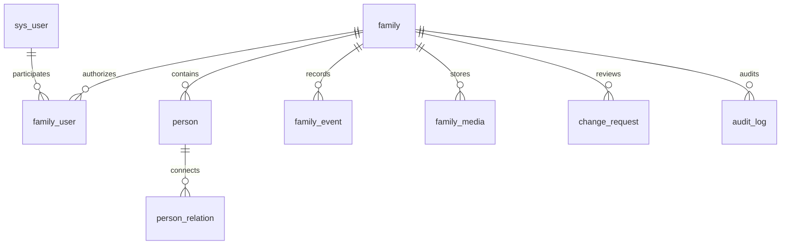

# 宗脉电子族谱需求数据库与接口说明

系统面向具有家族授权的账号提供人物档案、亲属关系与文化档案管理。核心交互为登录、选择家族、查看世系图、打开人物详情、维护资料与关系、刷新图谱。课程最小交付范围和推荐扩展均有对应页面和后端接口。

## 角色与访问范围

| 角色 | 可用操作 |
| --- | --- |
| 游客 | 查看管理员明确授权公开的家族名称、姓氏、简介 |
| 普通成员 | 查看家族可见人物、图谱和文化档案，提交自己的修改申请并查看处理结果 |
| 家族管理员 | 维护家族、人物、关系、事件、相册、账号关联、审核与导出 |
| 系统管理员 | 查看系统账号并启用或停用账号，家族数据维护仍使用相应家族授权 |

每个家族接口在后端校验账号状态及关联角色。`PRIVATE` 人物仅家族管理员可读，对普通成员的列表、图谱、关系、追溯和关联档案均进行过滤。相册文件通过带权限校验的接口读取。公开简介独立于人物档案授权。

## 技术实现

前端使用Vue 3与JavaScript，Element Plus提供表单、表格、弹窗和抽屉，G6 5.1.1负责Canvas绘图。后端使用Java 17、Spring Boot 3.3.5、Spring Security和JdbcTemplate。正式数据库使用MySQL 8，独立演示使用H2的MySQL兼容模式。

登录成功后保存 `JSESSIONID` Cookie，写请求先获取当前会话的CSRF令牌。Cookie设置HttpOnly和SameSite Lax，会话闲置超时为30分钟。后端重启后需要重新登录。

## 核心数据表

| 表 | 主要字段 | 用途 |
| --- | --- | --- |
| sys_user | id、username、password_hash、status | 独立登录账号，BCrypt密码哈希 |
| family | id、name、surname、ancestral_hall、hometown、motto、description、published、ancestor_person_id | 家族资料和始祖引用 |
| family_user | family_id、user_id、role | 多家族账号关联，复合唯一约束 |
| person | id、family_id、name、gender、generation、nickname、birth_date、death_date、birth_place、hometown、biography、avatar_url、visibility | 人物档案，日期和世代可空 |
| person_relation | family_id、from_person_id、to_person_id、relation_type、status | 亲子、收养、配偶关系 |
| family_event | family_id、title、event_date、location、content、person_id | 家族大事记 |
| family_media | family_id、title、person_id、event_id、file_name、content_type、file_data、visibility | 图片与文献，文件以BLOB保存 |
| change_request | family_id、applicant_id、kind、target_id、payload_json、original_json、status、reviewer_id、review_note | 修改申请及审核历史 |
| audit_log | family_id、operator_id、action、target、created_at | 成功写操作的账号、方法、对象和时间 |



人物与登录账号使用不同的编号空间。人物同名时仍按ID区分。配偶编号按小到大保存，交换双方提交也视为重复。亲子关系方向固定为父母到子女。收养与生物亲子分别标识，但统一参与环路检测和基础追溯。

## 一致性规则

关系写入先锁定家族行，再检查人物归属、重复关系和环路。反向关系的并发写入受同一事务锁约束。数据库外键和唯一约束提供最终一致性检查。

人物作为始祖、存在亲属关系或关联文化资料时，删除返回冲突提示。事件删除解除相册中的事件引用。头像图片删除同步清除人物头像地址。家族删除失败时事务回滚，保留原账号关联。

角色变更和移出账号同样使用家族事务锁，保留至少一位启用管理员。审核申请保存提交时的完整人物快照，批准前核对最新资料。如果资料已经变化，返回409并保留待处理状态。

## 接口约定

下列路径包含 `/api` 前缀。业务接口成功时返回JSON或空响应，错误一般返回 `status` 和 `message`。编号为正整数。分页从1开始，size范围为1至100。

| 方法 | 路径 | 行为 |
| --- | --- | --- |
| GET | /api/auth/csrf | 返回headerName与token |
| POST | /api/auth/register | username、password，成功201 |
| POST | /api/auth/login | 登录并建立会话 |
| GET | /api/auth/me | id、username、systemAdmin |
| POST | /api/auth/logout | 退出并失效会话 |
| GET | /api/public/families | 游客可读的授权家族简介 |
| GET、POST | /api/families | 当前账号家族列表、创建家族 |
| GET、PUT、DELETE | /api/families/{familyId} | 查询、更新、删除家族 |
| GET | /api/families/{familyId}/access | 当前家族角色能力 |
| PUT、DELETE | /api/families/{familyId}/ancestor | 指定或清除始祖 |
| GET、POST | /api/families/{familyId}/persons | 全量可见人物、创建人物 |
| GET | /api/families/{familyId}/persons/page | name、generation、birthYear、page、size筛选分页 |
| GET、PUT、DELETE | /api/families/{familyId}/persons/{personId} | 查询、完整更新、删除人物 |
| GET | /api/families/{familyId}/persons/{personId}/ancestors | 直系祖先列表 |
| GET | /api/families/{familyId}/persons/{personId}/descendants | 直系后代列表 |
| GET、POST | /api/families/{familyId}/relations | 关系查询、添加亲子关系 |
| POST | /api/families/{familyId}/relations/spouse | 添加配偶关系 |
| POST | /api/families/{familyId}/relations/adoptive | 添加收养关系 |
| DELETE | /api/families/{familyId}/relations/{relationId} | 删除关系 |
| GET | /api/families/{familyId}/tree | family、persons、relations |
| GET | /api/families/{familyId}/stats | 人数、关系、事件及世代分布 |
| GET、PUT | /api/families/{familyId}/members | 账号列表、按username维护role |
| DELETE | /api/families/{familyId}/members/{userId} | 移出家族 |
| GET、POST | /api/families/{familyId}/events | 事件列表、创建事件 |
| PUT、DELETE | /api/families/{familyId}/events/{eventId} | 修改、删除事件 |
| GET、POST | /api/families/{familyId}/media | 档案列表、multipart上传 |
| GET | /api/families/{familyId}/media/{mediaId}/file | 权限校验后读取文件 |
| DELETE | /api/families/{familyId}/media/{mediaId} | 删除档案并清理头像引用 |
| GET、POST | /api/families/{familyId}/requests | 可见申请列表、提交申请 |
| POST | /api/families/{familyId}/requests/{requestId}/review | approve与note审核 |
| GET | /api/families/{familyId}/audit | 最近500条家族操作日志 |
| GET | /api/families/{familyId}/export?format=json或csv | 管理员导出 |
| POST | /api/demo-families | 为当前账号创建新五代演示家族 |
| GET | /api/system/users | 系统管理员读取账号 |
| PATCH | /api/system/users/{userId} | 系统管理员维护账号status |

## 请求与响应示例

创建亲子关系时父母在前，子女在后。

```json
{"parentPersonId": 101, "childPersonId": 102}
```

创建配偶关系使用两个成员编号。

```json
{"personId": 101, "spousePersonId": 103}
```

分页返回记录和总数。

```json
{"records": [], "total": 0, "page": 1, "size": 10}
```

普通成员申请添加关系。

```json
{"kind":"PARENT_CHILD","payload":{"fromPersonId":101,"toPersonId":102}}
```

申请类型支持 `PERSON_UPDATE`、`PARENT_CHILD`、`ADOPTIVE_PARENT_CHILD` 和 `SPOUSE`。修改人物时还需 `targetId` 与完整人物字段。日期采用 `YYYY-MM-DD`，未知值用null。人物PUT覆盖可写资料，调用方应保留原有字段。

## 图谱处理

图谱读取全量可见人物和真实关系。先按配偶构建布局组，再以亲子关系做拓扑分层。配偶合并导致布局成环时，回退到独立人物的亲子层级。算法只调整展示坐标。祖先与后代集合由亲子边遍历生成并去重，generation字段用于显示与筛选。

图谱交互包含节点选择、详情抽屉、父母配偶子女及兄弟姐妹列表、缩放拖动、人物定位、祖先后代范围、后代折叠和PNG导出。人物与关系保存后重新加载接口数据。
